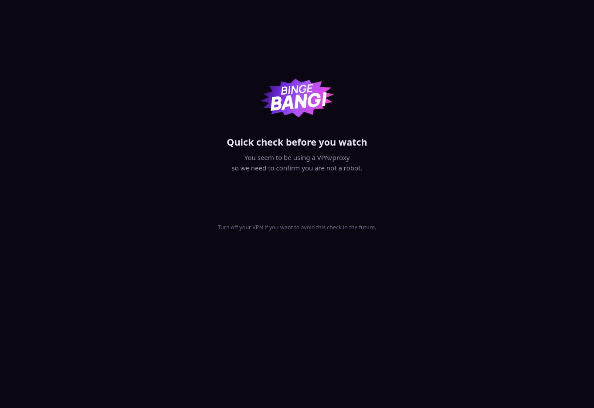
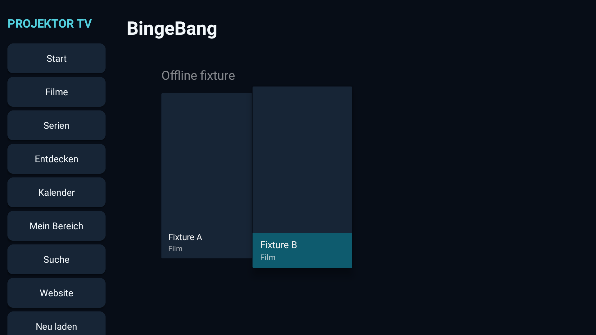
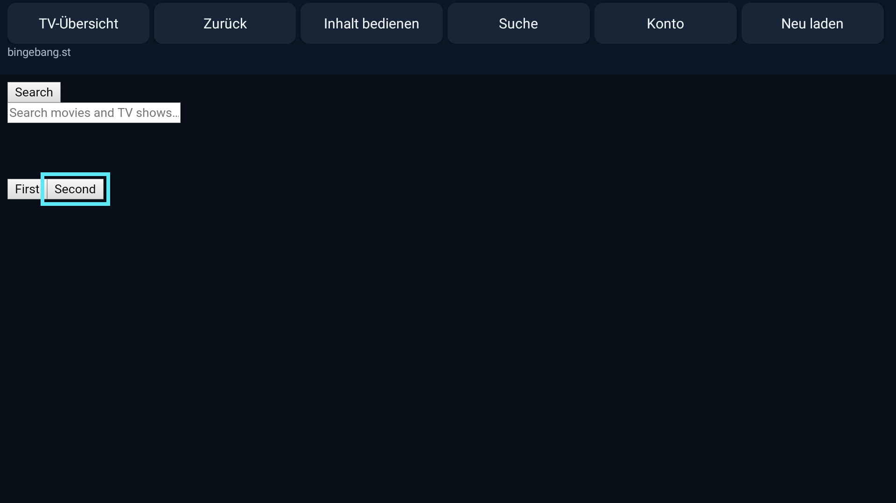
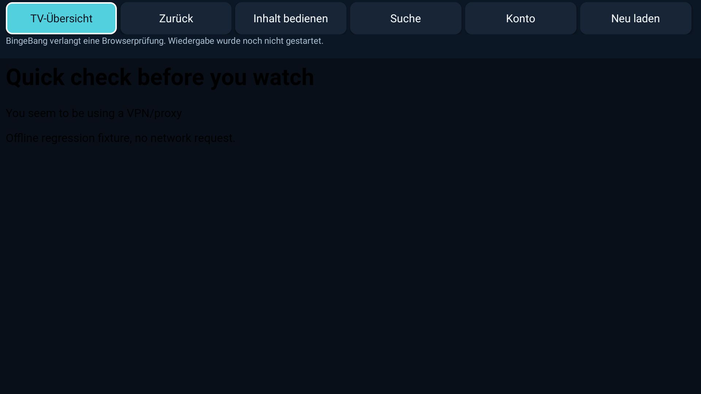

# Verifizierter Stand 0.6.0-device-check

Datum: 20.10.2026. Gesamtziel „funktionierender BingeBang-Streaming-Client auf Xgimi“: **nicht abgenommen**.

## Unverwechselbarer Build

- App-Quellcommit: `893c934d5fec1b7380f120964b8591df1c100712`.
- [Erfolgreicher CI-Lauf 39483073752](https://github.com/fabu-maker/xgimi-tv-client/actions/runs/39483073752).
- [Vorabversion v0.6.0-device-check](https://github.com/fabu-maker/xgimi-tv-client/releases/tag/v0.6.0-device-check).
- APK: `projektor-tv-device-check.apk`, 7.377.678 Bytes.
- APK-SHA-256: `481d97ca86a092b959c03b2d4317727027829d3857beda262409a43772e6d7aa`.
- Paket: `dev.projectortv.client`, versionCode `6`, versionName `0.6.0-device-check`, minSdk 28, targetSdk 35.
- Signatur: APK Signature Scheme v2, ein RSA-3072-Signer.
- Zertifikats-SHA-256: `c5733ec4c9ae98ff546faad957b2310f65386c419c7d12f63a6444e8ad68b94b`.

`apksigner verify --verbose --print-certs` lief im Releasejob erfolgreich. Der Workflow verglich den Fingerabdruck mit der bisherigen Projektsignatur. Nach Veröffentlichung wurde die APK erneut heruntergeladen und ihre SHA-256-Prüfsumme gegen die veröffentlichte Prüfsummendatei kontrolliert: stimmt überein. Lizenzassets sind enthalten. Die Debug-Testaktivität und synthetischen Testtitel wurden in den Release-DEX-Dateien nicht gefunden.

Die Release-Anlagen `signature.txt`, `package.txt`, `runtime-licenses.txt` und `verified-evidence.zip` bewahren Signaturausgabe, Paketdaten, das Versions-/Lizenzinventar und die Testberichte einschließlich Screenshots. Die nachfolgende Dokumentationsänderung verändert diesen APK-Quellcommit nicht.

## Automatisierte Prüfungen

| Prüfung | Tatsächliches Ergebnis | Grenze |
|---|---|---|
| Debug-/Test-/Release-Kompilierung | erfolgreich | kein Wiedergabenachweis |
| JVM-Tests | 5 bestanden, 0 Fehler, 0 übersprungen | URL-Policy und vorhandene HTML-/Posterparser; auch beibehaltene Parsermethoden des Altprojekts |
| Release-Lint | 0 Fehler, 12 Warnungen | keine Aussage über externe Websitefunktionen |
| Laufzeitlizenzen | 45 aufgelöste Module, Apache 2.0 / MIT; POM-Eltern und verschachtelte AAR-JARs berücksichtigt | keine Sicherheitsprüfung der gesamten Drittquellen |
| Android-TV-Instrumentierung | 4 bestanden, 0 Fehler, 0 übersprungen | ausschließlich Offline-Testdaten, keine BingeBang-Requests |
| Screenshots | 3 gesichert und visuell angesehen | keine realen Filmcover oder Videobilder |
| Signatur und Downloadhash | bestanden | physische Installation auf Xgimi offen |

Die vier auf dem Emulator ausgeführten Instrumentierungstests prüfen:

1. Gelesene Titel-Links aus derselben Website-Origin, Ablehnung fremder/namensloser Links und keine Ausgabe von Formularwerten.
2. Öffnen/Fokussieren eines zuvor versteckten Suchfelds über die Suchschaltfläche und tatsächliche D-Pad-Navigation zwischen HTML-Schaltflächen.
3. Anzeige der simulierten Browserprüfseite mit ausdrücklichem Hinweis, dass keine Wiedergabe gestartet wurde, ohne Ersatzkatalog.
4. D-Pad-Rechts und OK auf nativen Karten, Öffnen der Detailansicht, Zurück und Beibehalten der ausgewählten zweiten Karte.

Bildschirmtastatur-Eingabe, reale Suchergebnisse, Playersteuerung und Kontosynchronisation sind durch diese Tests nicht belegt.

Emulator: Android TV 10, API 29, x86, Profil `tv_1080p`, 1920 × 1080. Build-Fingerprint: `google/sdk_google_atv_x86/generic_x86:10/QTU1.200805.001/6738020:user/test-keys`. WebView: `com.google.android.webview`, Version `83.0.4103.101`. Dies ist ein älteres TV-Systemimage und kein aktueller Google-TV- oder Xgimi-Kompatibilitätsnachweis.

### Verbleibende Lint-Warnungen

| Kategorie | Anzahl | Bedeutung |
|---|---:|---|
| OldTargetApi | 1 | targetSdk 35 ist nicht die neueste Android-Version |
| GradleDependency | 3 | neuere AndroidX-Testbibliotheken verfügbar |
| DiscouragedApi | 1 | feste Querformat-Ausrichtung für TV |
| DataExtractionRules | 1 | zusätzlich zu `allowBackup=false` fehlt eine Android-12-Regeldatei |
| UnusedResources | 2 | ältere Icon-/Bannerressourcen unbenutzt |
| IconLauncherShape | 1 | Launcher-Icon füllt die quadratische Fläche |
| SetTextI18n | 3 | fest eingebundene deutsche Texte |

## Beobachtungen an der echten Website

Die Startseite und ein realer Film-Play-Link wurden im Desktop-Cloud-Browser geöffnet. Beim Filmstart erschien „Quick check before you watch“ mit VPN-/Proxy-Hinweis. Kein Videoelement wurde geladen. Ein einmaliges Neuladen beseitigte das Hindernis nicht. Auch der gesicherte Screenshot zeigt kein bedienbares CAPTCHA-Widget. Danach wurden keine anderen Routen, Clients oder Netzwerkwege zum Umgehen der Prüfung versucht.

Dieser konkrete Zugriff ist blockiert. Eine generelle Unmöglichkeit auf dem privaten Xgimi ist damit nicht bewiesen. Es gibt keinen bestätigten BingeBang-API-Vertrag, keine verifizierte Medienquelle und keinen Login-Nachweis. Ein vollständiger HAR-Mitschnitt liegt nicht vor.

| Reale Funktion | Stand |
|---|---|
| Desktop-Startseite und Film-Link | gesehen / geöffnet |
| Originalplayer mit Bild und Ton | nicht erreicht |
| Serienepisode | nicht geprüft |
| Registrierung / Anmeldung | nicht geprüft |
| Echte Merkliste / Verlauf / Weiterschauen | nicht geprüft |
| Pause / Spulen / Untertitel / Vollbild mit echtem Video | nicht geprüft |
| Physischer Xgimi, Fernbedienung und Wiederöffnen | kein Gerät verbunden, nicht geprüft |

Die detaillierte SmartTube- und Architekturprüfung steht im [Audit](SMARTTUBE_BINGEBANG_AUDIT.md).

## Bildbelege

Echte Website im Desktop-Browser; kein Android-TV-Test:

Android-TV-Emulator mit synthetischen Offline-Testdaten; keine echten Katalogeinträge:

## Korrigierte Fehler während der Entwicklung

Der erste neue CI-Lauf stoppte korrekt an einer aus einem Maven-Eltern-POM geerbten Guava-Lizenz. Die Auflösung berücksichtigt nun POM-Eltern. Im Lauf 39481612771 bestanden acht damalige JVM- und vier TV-Tests; anschließend scheiterte das Einsammeln der Screenshots, weil das Testsystem die App und ihre Dateien deinstallierte. Die Screenshots werden jetzt außerhalb dieses App-Verzeichnisses gesichert. Drei Tests für den inzwischen entfernten lokalen Favoriten-/Navigationsaltcode entfallen. Zwei Zwischenläufe wurden durch neuere Commits abgebrochen und nicht als bestandene Prüfungen gewertet.
